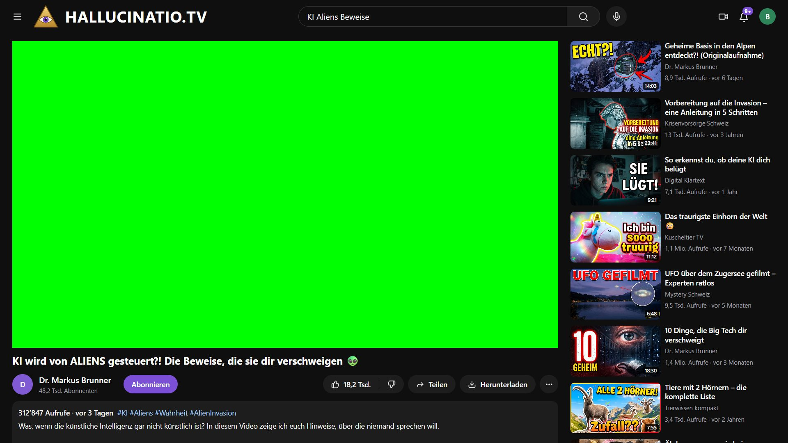

# Videoportal – Film-Requisite

Eine **fiktive Videoplattform** für Bildschirmaufnahmen in Filmen (z.B. mit OBS).
Name, Logo, Video, Kanal, Kommentare und Vorschläge werden pro Film in einer einzigen Datei festgelegt.
Der Videobereich ist eine leere Fläche, das eigentliche Video wird im Schnitt eingesetzt.

*A fictional video platform used as an on-screen prop for film productions. German UI, configurable per film.*



## Funktionen

- **Pro Film konfigurierbar:** Portalname, Logo, Farben, Videotitel, Kanal, Beschreibung, Kommentare, Vorschläge mit Thumbnails
- **Echte Kommentarfunktion:** Eine Figur kann vor der Kamera einen Kommentar tippen und absenden. Nach F5 ist er wieder weg, bereit für den nächsten Take.
- **Videoplatzhalter für den Schnitt:** eckige 16:9-Fläche, wahlweise als Greenscreen, auf ganze Bildschirmpixel ausgerichtet
- **Realistische Zahlen:** Aufrufe, Likes und Alter werden automatisch erzeugt, „zufällig, aber stabil“ (bei jedem Neuladen gleich, wichtig für Anschlüsse zwischen Takes)
- **Für Aufnahmen optimiert:** vergrößerte Darstellung, keine Entwickler-Einblendungen, Titel und Icon im Browser-Tab passend zum Portal

## Starten

Voraussetzung: [Node.js](https://nodejs.org) 20 oder neuer.

```bash
npm install   # einmalig
npm run dev
```

Dann im Browser öffnen: `http://localhost:3001/?film=aliens`
Ohne `?film=` wird der Standardfilm aus `src/data/films/index.ts` geladen.

## Neuen Film anlegen

1. `src/data/films/aliens.ts` kopieren, z.B. nach `meinfilm.ts`, und die Parameter anpassen (siehe unten).
2. Bilder (Logo, Thumbnails) nach `public/films/meinfilm/` legen und mit `/films/meinfilm/bild.jpg` referenzieren.
3. Den Film in `src/data/films/index.ts` importieren und in `films` eintragen.
4. Aufrufen mit `http://localhost:3001/?film=meinfilm`.

## Parameter einer Film-Datei

| Parameter | Bedeutung |
|---|---|
| `production` | Name der Produktion, nur zur Orientierung |
| `portalName` | Portalname neben dem Logo und im Browser-Tab; `""` = nur Logo |
| `portalLogo` | eigenes Logo (auch Tab-Icon); ohne Angabe Kreis mit Play-Symbol |
| `portalLogoHeight` | Höhe des Logos, Standard `"28px"` |
| `portalNameSize` | Schriftgröße des Portalnamens, z.B. `"2xl"` oder `"32px"`, Standard `"lg"` |
| `accentColor` | Farbe von Standard-Logo und Buttons, Standard `"#e8452c"` |
| `background` | Hintergrundmuster, `"plain"` (Standard) oder `"dots"` |
| `username` | Wer schaut, z.B. `"Ben"` → Avatar „B“, eigene Kommentare als „@ben“ |
| `searchbarText` | Text im Suchfeld |
| `filmTitle` | Titel des Videos |
| `videoDescription` | Beschreibung unter dem Video |
| `hashTags` | z.B. `["#KI", "#Aliens"]` |
| `channelName` | Kanal des Videos |
| `followersAmount` | Abonnenten als Zahl, z.B. `48200` → „48,2 Tsd. Abonnenten“ |
| `likesAmount` | Likes als Zahl |
| `viewsAmount` | Aufrufe als Zahl, z.B. `312847` → „312’847 Aufrufe“ |
| `uploadedAgo` | z.B. `"vor 3 Tagen"`; ohne Angabe Zufallswert |
| `placeholderColor` | Farbe der Videofläche, Standard Schwarz; Greenscreen z.B. `"#00ff00"` |
| `placeholderLabel` | Text in der Videofläche, Standard „Videocontainer“; `""` = kein Text |
| `trackingPoints` | `true` = 4 Tracking-Kreuze in der Videofläche, zum Abfilmen des Bildschirms mit einer Kamera |
| `videoRecommendations` | Liste mit `recFilmTitle`, `recChannel`, `recImg` (optional), `recLength` |
| `comments` | Liste mit `channel` und `text` |

Aufrufe und Alter der Vorschläge, Alter und Likes der Kommentare, Anzahl Kommentare und Avatarfarben
werden aus dem jeweiligen Text berechnet. Wer andere Werte will, ändert den Text leicht. Details in `src/lib/fake.ts`.

## Tipps für die Aufnahme

- **Eigenes Browserprofil ohne Erweiterungen** verwenden. Passwortmanager & Co. blenden sonst Symbole ein.
- **Browser-Zoom 100 %** und Vollbild (F11). Dann liegt die Videofläche bei 1920×1080 exakt bei
  x = 30, y = 100 mit 1330 × 748 px (bei Windows-Skalierung 100 %).
- Vor jedem Take **F5**, danach kurz warten, bevor ins Kommentarfeld geklickt wird.
- Die Gesamtgröße stellt `contentZoom` in `src/components/portal/Portal.tsx` ein (Standard 1.25).
- Videodateien (`.mp4`, `.mov`, …) werden von Git ignoriert und gehören nicht ins Repo.

## Hinweis

Alle Namen, Kanäle, Kommentare und Inhalte sind **frei erfunden**. Das Portal steht in keiner Verbindung
zu einer real existierenden Plattform. Die Thumbnails im Beispielfilm wurden mit KI generiert.

## Lizenz

[MIT](LICENSE)
